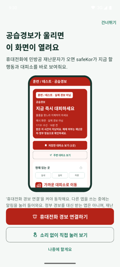
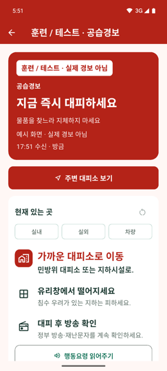
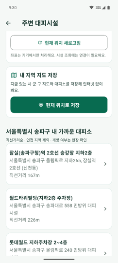
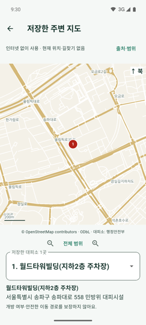
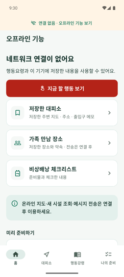
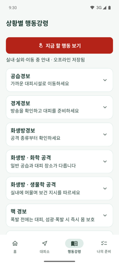
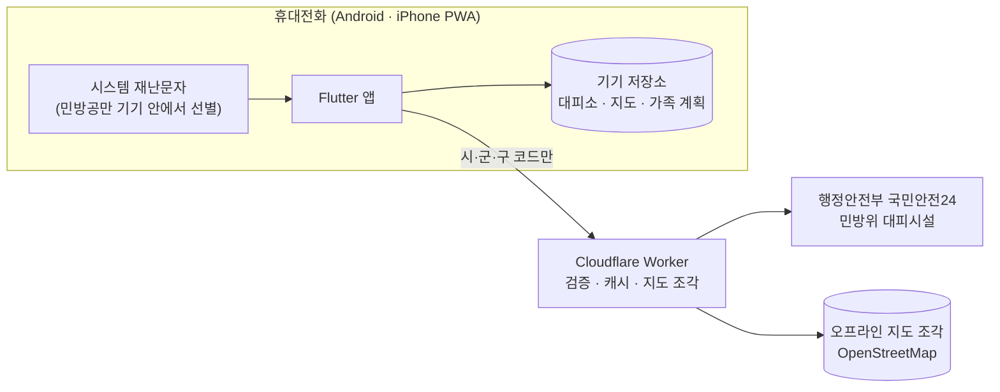

# safeKor

### 경보가 울린 순간, 지금 할 행동부터

공습경보 재난문자가 오면 할 일과 가까운 대피소를 바로 보여주고, 
인터넷이 끊겨도 미리 저장한 대피소·지도·행동요령을 꺼내 볼 수 있는 민간 비상 대비 앱입니다.

  
  

**경보 수신 &nbsp; → &nbsp; 지금 할 행동 &nbsp; → &nbsp; 가까운 대피소 &nbsp; → &nbsp; 오프라인에서도**

---

## 경보는 들었는데, 그다음은?

공습경보 재난문자는 짧습니다. 어디로 가야 하는지, 실내에 있으면 무엇을 해야 하는지, 가족과는 어디서 만나기로 했는지 그 순간에 찾아보기는 어렵습니다. 통신이 불안정해지면 더 그렇습니다.

**safeKor는 그 사이를 미리 채워 둡니다.** 평소에 주변 대피소와 지도를 기기에 저장하고 가족 만남 장소를 정해 두면, 휴대전화에 민방공 재난문자가 왔을 때 지금 할 행동과 저장한 대피소가 한 화면에 열립니다.

 

## Meet safeKor

<table>
  <tr>
    <th align="center" width="33%">01 · 경보가 울리면</th>
    <th align="center" width="33%">02 · 지금 할 행동</th>
    <th align="center" width="33%">03 · 가까운 대피소</th>
  </tr>
  <tr>
    <td align="center"></td>
    <td align="center"></td>
    <td align="center"></td>
  </tr>
  <tr>
    <td align="center">첫 실행에서 경보 때 열릴 화면을 미리 보여줘요</td>
    <td align="center">실내·실외·차량별 우선 행동을 한 화면에</td>
    <td align="center">정부 등재 민방위 대피소를 직선거리순으로</td>
  </tr>
</table>

<table>
  <tr>
    <th align="center" width="33%">04 · 저장한 주변 지도</th>
    <th align="center" width="33%">05 · 인터넷이 끊기면</th>
    <th align="center" width="33%">06 · 상황별 행동강령</th>
  </tr>
  <tr>
    <td align="center"></td>
    <td align="center"></td>
    <td align="center"></td>
  </tr>
  <tr>
    <td align="center">대피소를 저장하면 주변 도로 지도도 기기에</td>
    <td align="center">연결이 없으면 저장한 것만 모아 바로 보여줘요</td>
    <td align="center">공습·화생방·핵 경보별 안내 인터넷 없이 확인</td>
  </tr>
</table>

2026.11.11 · Android 에뮬레이터에서 직접 촬영한 앱 화면 · 대응 화면은 훈련 표시가 있는 예시입니다

 

## 미리 준비하는 방법

| | safeKor가 도와주는 일 |
| :--- | :--- |
| **경보와 연결** | Android에서 ‘휴대전화 경보 연결’을 켜면, 시스템 재난문자 중 민방공 발령만 기기 안에서 골라 대응 화면을 엽니다. 원문은 저장하거나 전송하지 않습니다. |
| **대피소 찾기** | 현재 위치나 시·군·구를 골라 국민안전24에 등재된 민방위 대피시설을 조회합니다. 조회 시각과 출처를 함께 표시합니다. |
| **오프라인 저장** | 대피소를 저장하면 주변 도로 지도도 함께 내려받습니다. 지금 있는 시·군·구 전체 지도도 저장할 수 있습니다. |
| **가족과 약속** | 첫 번째·대체 만남 장소와 약속을 기기에 저장하고, 원하는 메신저로 직접 공유합니다. |
| **평소 연습** | 훈련 표시가 붙은 모의 경보 화면과 비상배낭 체크리스트로 미리 익혀 둡니다. |

 

## Under the hood

### 정부 자료를 그대로, 검증해서

대피소는 국민안전24에 등재된 민방위 대피시설만 보여줍니다. Worker가 원천 응답의 출처·지역·건수·좌표를 검사하고 맞지 않으면 버립니다. 임의로 만든 시설이나 경로는 표시하지 않고, 가까운 거리가 안전이나 개방 여부를 뜻하지 않는다는 점을 화면마다 알립니다.

### 끊겨도 쓸 수 있게

행동요령은 앱에 들어 있고, 저장한 대피소와 지도는 기기에 보관합니다. 연결이 끊기면 홈이 오프라인 화면으로 바뀌어 저장한 것만 모아 보여줍니다. 지도는 OpenStreetMap 도로 데이터를 구역별로 미리 잘라 두고, 필요한 조각만 받습니다.

### 실제 경보와 훈련을 섞지 않게

safeKor는 정부 경보를 대신 받는 앱이 아닙니다. 재난문자·정부 방송이 우선이며, 모의 화면과 테스트 알림에는 항상 ‘훈련 / 테스트’ 표시가 붙습니다. 회원가입이 없고, 위치는 선택 기능입니다.

 

## Built with

| App | Server | Data | Release |
| :--- | :--- | :--- | :--- |
| Flutter · Dart | Cloudflare Workers | 국민안전24 민방위 대피시설 | Google Play (비공개 테스트) |
| Android 알림 연결 (Kotlin) | Workers Cache · Rate Limit | OpenStreetMap 도로 데이터 | Shorebird 코드 업데이트 |
| iPhone PWA | Web Push | 행정안전부 행동요령 | GitHub Actions |

 

## Our repositories

| 저장소 | 역할 |
| :--- | :--- |
| [safe-korea](https://github.com/safe-korea/safe-korea) | Flutter 앱 · PWA · 대피소 조회 Worker |

---

**평소에 준비하고, 경보가 울리면 바로. safeKor.**

[웹에서 써보기](https://safe-korea-shelter-api.trovapp.workers.dev/app/) &nbsp; · &nbsp; [개인정보처리방침](https://safe-korea-shelter-api.trovapp.workers.dev/privacy) &nbsp; · &nbsp; [문의·도움말](https://safe-korea-shelter-api.trovapp.workers.dev/support)

정부·지자체 공식 앱이 아니며, 공식 기관의 인증이나 제휴를 의미하지 않습니다.

